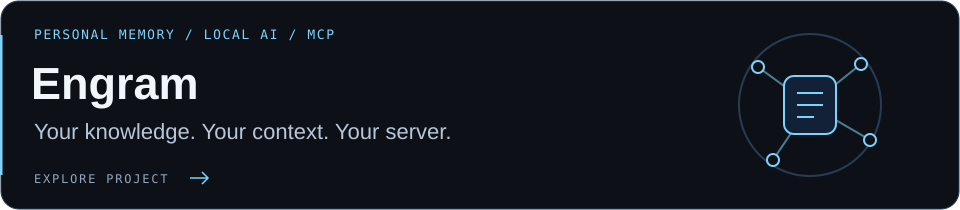
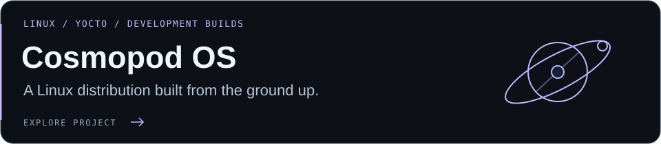
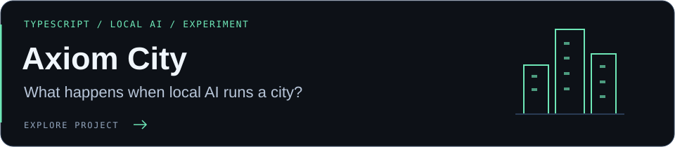
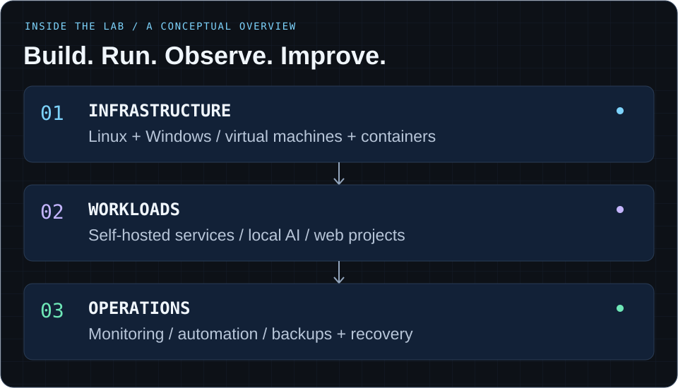

  <picture>
    <source media="(prefers-color-scheme: light)" srcset="assets/header-light.svg" />
    <source media="(prefers-color-scheme: dark)" srcset="assets/header.svg?v=2" />
    
  </picture>

  
  
  

## I build systems. Then I keep them running.

I'm **Jayden**, a **Junior IT Technician at the University of Huddersfield** with a BCS Level 4 DevOps Engineer apprenticeship. I work across technical support, infrastructure and automation, and build self-hosted projects that turn ideas into working systems.

I like understanding what happens under the hood: how systems behave, why they fail, and how to make recovery straightforward. If I build it, I care about keeping it alive.

- **Infrastructure & reliability** — Linux and Windows, virtualisation, containers, monitoring, backups and recovery.
- **Practical automation** — Python, PowerShell and Bash to reduce repetitive work and make problems easier to diagnose.
- **Local AI & experiments** — self-hosted inference, useful AI integrations and the occasional simulated city.

## Currently building

- **[Engram](https://github.com/Jxyden34/Engram):** refining local AI memory, reflection and reviewed project briefs.
- **[Cosmopod OS](https://github.com/Jxyden34/cosmopod-os):** working through development images, hardware testing and update/recovery qualification.

Across both, I'm focused on useful automation, clear documentation and systems I can recover when something breaks.

Focus snapshot: October 2026. The badges below pull release, version and workflow data from GitHub.

## Featured project · Engram

<a href="https://github.com/Jxyden34/Engram">
  <picture>
    <source media="(prefers-color-scheme: light)" srcset="assets/project-engram-light.svg" />
    <source media="(prefers-color-scheme: dark)" srcset="assets/project-engram-dark.svg" />
    
  </picture>
</a>

[**Engram**](https://github.com/Jxyden34/Engram) brings documents, saved pages and conversations together in a self-hosted personal memory and AI context platform. It combines local Ollama processing, source-aware retrieval, human review and project-scoped MCP access, with encrypted backups and isolated restore checks.

[Explore Engram ↗](https://jxyden34.github.io/Engram/) · [Deployment guide](https://github.com/Jxyden34/Engram/blob/main/docs/DEPLOYMENT.md) · [Connect an MCP client](https://github.com/Jxyden34/Engram/blob/main/docs/OAUTH-MCP.md)

Source-available. Free for personal, noncommercial self-hosting; commercial and workplace use require separate written permission.

## More things I'm building

<a href="https://github.com/Jxyden34/cosmopod-os">
  <picture>
    <source media="(prefers-color-scheme: light)" srcset="assets/project-cosmopod-light.svg" />
    <source media="(prefers-color-scheme: dark)" srcset="assets/project-cosmopod-dark.svg" />
    
  </picture>
</a>

Development version and repository checks; image and hardware qualification are ongoing.

<a href="https://github.com/Jxyden34/Axiom-City">
  <picture>
    <source media="(prefers-color-scheme: light)" srcset="assets/project-axiom-light.svg" />
    <source media="(prefers-color-scheme: dark)" srcset="assets/project-axiom-dark.svg" />
    
  </picture>
</a>

Experimental project. No published release or build workflow yet.

| Project | What it's about | Focus |
| :--- | :--- | :--- |
| [**Endpoint remediation**](https://github.com/Jxyden34/StaleTeamsProfileRemidiation)  | A project proposal for detecting stale Windows profiles and safely remediating legacy Teams remnants. | PowerShell · Intune |
| [**hindley.tech**](https://hindley.tech)  | My portfolio, technical projects and experiments in interactive web design. | Web · Self-hosting |

## Tools I reach for

  
  
  
  
  
  
  
  
  

**Also in the mix:** Microsoft Intune, Azure, Proxmox, KVM/libvirt, Node.js, Next.js, WireGuard and GPU workloads.

## Inside the lab

The projects are the visible part. Underneath, I enjoy the work that keeps them useful: running services, watching for problems, automating the repetitive bits and making recovery manageable.

<strong>Open the blueprint → infrastructure, workloads and operations</strong>

 

<picture>
  <source media="(prefers-color-scheme: light)" srcset="assets/lab-light.svg" />
  <source media="(prefers-color-scheme: dark)" srcset="assets/lab-dark.svg" />
  
</picture>

- **Infrastructure:** Linux and Windows, virtual machines and containers.
- **Workloads:** self-hosted services, local AI and web projects.
- **Operations:** monitoring, automation, backups and recovery.

A conceptual overview of how I approach the lab.

## Activity & after hours

  
  

Public repository stats; language percentages describe repository code, not proficiency.

### One more thing: feed the snake.

My contribution graph, with a little more movement.

<picture>
  <source media="(prefers-color-scheme: dark)" srcset="assets/contribution-snake-dark.svg?v=1" />
  <source media="(prefers-color-scheme: light)" srcset="assets/contribution-snake.svg?v=1" />
  
</picture>

Generated weekly from my contribution graph with [snk](https://github.com/Platane/snk). [Prefer the static graph?](https://github.com/Jxyden34?tab=overview#year-list-container)

## Away from the terminal

Retro handhelds, customising my Nintendo DSi and finding new things to do with older hardware. The same curiosity, just with a smaller screen.

---

Curious about infrastructure, automation or local AI? <a href="mailto:jayden@hindley.tech">Let's talk.</a>

